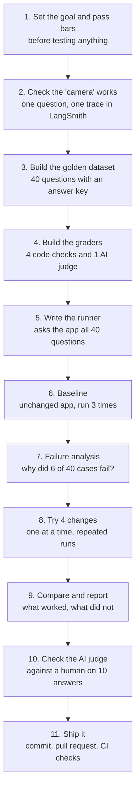
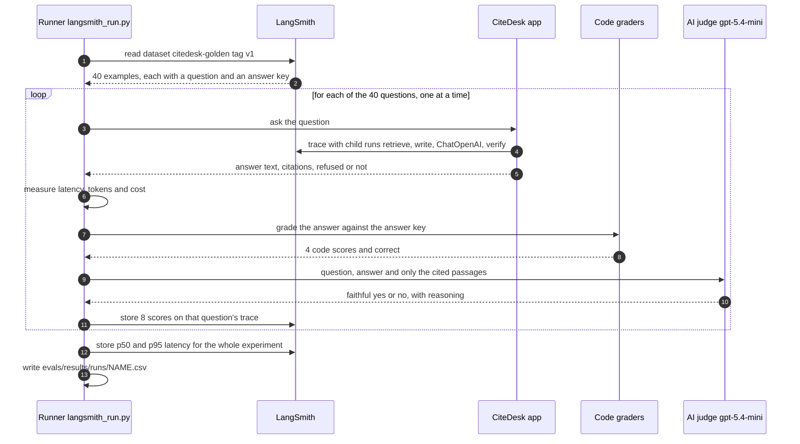
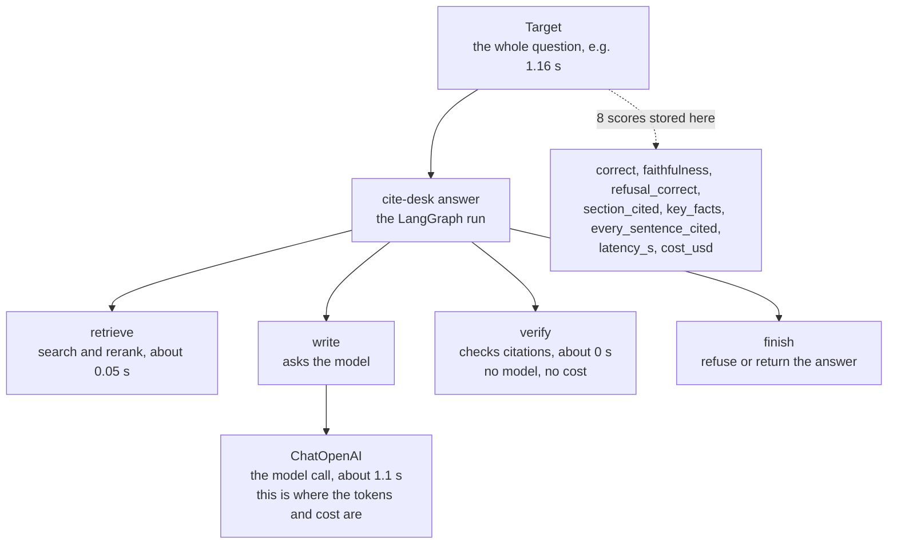
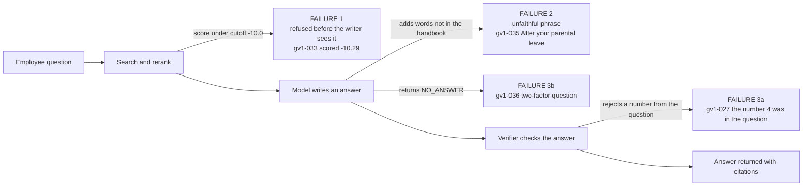
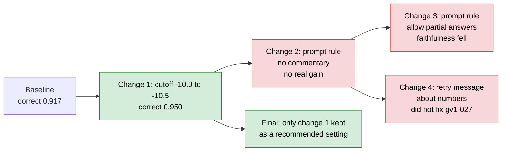

# Week 4 walkthrough: how I evaluated CiteDesk, step by step

This page explains the whole evaluation from scratch, in plain language: what I did, **why** I did it, where the code and data live, what I sent to LangSmith, and what came back. You do not need to know anything about evaluation first. For a one-page summary see [week4-evaluation.md](week4-evaluation.md); for the full report see `evals/results/improvements-report.md`.

## 1. The idea in one minute

CiteDesk is like a student who answers questions from a handbook. The rules: **quote the page you got the answer from**, and **say "I can't answer that" when the handbook doesn't cover it**.

The Week 4 question was: *how good is this student, and can I prove that a change makes it better?* A demo that works once proves very little. So I built an exam:

| School exam | What I built | Plain meaning |
|---|---|---|
| Exam questions and an answer key | **Golden dataset** (40 questions) | Questions where the right behavior was written down *before* testing |
| The teacher marking | **Graders** (4 code checks) | Rules that mark each answer pass or fail |
| A second marker for judgment calls | **AI judge** | Checks the answer says nothing the handbook doesn't say |
| Security-camera footage | **Traces in LangSmith** | A recording of every step the app took for each question |
| Retaking the exam | **Running everything 3 times** | The same student scores a little differently each time |
| Trying study methods | **4 changes** | Four ideas, each tested the same way |
| Grade before and after | **Baseline vs improved** | Did the score really move, or was it luck? |

## 2. The whole journey



## 3. Words you will see

| Word | Meaning |
|---|---|
| **Golden dataset** | A list of test questions, each with the correct answer or behavior written down in advance. |
| **Refusal** | The app saying "I can't answer that from the handbook" instead of guessing. |
| **Faithfulness** | The answer says only what the handbook says. An added phrase that sounds right but isn't in the handbook is *not* faithful. |
| **Trace** | A recording of everything the app did for one question: each step, its time, and its tokens. |
| **LangSmith** | A website that stores traces, datasets and scores, and lets you compare runs. |
| **Experiment** | One run of all 40 questions, stored in LangSmith under a name like `baseline-v1-795b0253`. |
| **Grader** | A small function that scores an answer. Returns pass, fail, or "does not apply". |
| **LLM judge** | A second AI model that grades whether an answer is faithful. |
| **Baseline** | The score *before* any change. Everything is compared against it. |
| **Noise** | Random variation. The same unchanged app scored 90% and 92.5%. One case is worth 2.5 points, so tiny moves mean nothing. |
| **Relevance cutoff** | A score below which the app treats search results as "not relevant" and refuses. It is `LOCAL_MIN_RELEVANCE = -10.0` in `src/citedesk/config.py`. |
| **Verifier** | A built-in checker (`src/citedesk/answer/verifier.py`) that rejects an answer if a number or name is not in the cited passage. |
| **Quality gate** | A repo test (`evals/baselines.json`) that fails the build if quality drops. It is never weakened to make a build pass. |

## 4. Step by step

### Step 1. Set the goal and the pass bars first

**What:** I wrote down what "good enough" means *before* running anything.

**Why:** If you pick the target after seeing the scores, you can always make yourself pass. Fixing it first keeps the test honest.

| Metric | Pass bar |
|---|---|
| Faithfulness | at least 0.90 |
| Refusal correct | at least 0.95 |
| Every sentence cited | 1.00 |
| Right section cited | at least 0.90 |
| Key facts present | at least 0.90 |
| p95 latency (the slowest 5% of questions) | under 3 s |
| Cost per question | under $0.001 |

### Step 2. Check the "camera" works (tracing)

**What:** I asked one real question with tracing on and read the recording back from LangSmith.

**Why:** Every later score links to a trace. If the camera is broken, nothing else is trustworthy.

**Code:** `src/citedesk/tracing.py` (the `Tracer`, **off by default**, because a trace contains the question and handbook text, which leaves this system for a third party). It is switched on with `CITEDESK_LANGSMITH_TRACING=true` and a key in `.env`. `src/citedesk/answer/service.py` names each run `cite-desk answer` and attaches metadata.

**What I got:** a trace with the steps `retrieve` (0.26 s) then `write` (1.9 s, a `ChatOpenAI` call with 484 tokens) then `verify`. Almost all the time and cost is the model call.

**What I added:** a `prompt_version` label on every trace. It is the first 8 characters of a hash of the prompt text (`PROMPT_VERSION` in `src/citedesk/adapters/openai_writer.py`, passed through `App.prompt_version` in `src/citedesk/bootstrap.py`). It changes by itself when the prompt changes, so a "before" run and an "after" run can never be mixed up. The original prompt's version is `d4827b68`.

### Step 3. Build the golden dataset

**What:** 40 handbook questions in `evals/golden_v1.json`. Each has the question, the expected behavior (answer with citations, or refuse), the handbook section that should be cited, a reference answer, and facts the answer must contain.

**Why:** Without an answer key written in advance, you can only say "that looks fine". With one, a computer can score thousands of answers the same way every time.

| Scenario | Cases | From existing sample questions | Drafted by Claude |
|---|---|---|---|
| Happy path (normal questions) | 20 | 20 | 0 |
| Edge (multi-part, ambiguous, unanswerable) | 12 | 9 | 3 |
| Known failure (hard cases) | 6 | 4 | 2 |
| Adversarial (prompt injection) | 2 | 0 | 2 |
| **Total** | **40** | **33** | **7 (17.5%)** |

**Why harder cases were added:** the real model already passed about 97% of the existing sample questions, so there was no room to show an improvement.

**Review:** every label was checked against the handbook (`data/sample/acme-handbook.md`, a 2 KB synthetic company handbook). The review found flaws in the answer key itself, fixed before any scoring. For example, one case required citing a section the answer did not need. The human review record is `evals/golden_v1_review.csv`.

**Which documents the app can see:** only `acme-handbook.md`, in a throwaway database (`build_sample_app` in `src/citedesk/evaluation/runner.py`). The development database also holds a second handbook version with different numbers, which would silently change the right answers, so it is never used.

**What I sent to LangSmith:** the file `evals/golden_v1_langsmith_upload.csv`, uploaded in the LangSmith UI as the dataset `citedesk-golden`, then tagged **`v1`**. The tag matters: changing a case later would invalidate every comparison, so a change must become `v2`.

| LangSmith field | What I put in it |
|---|---|
| Input | `question` |
| Reference output (the answer key) | `reference_answer`, `expected_behavior`, `gold_sections`, `must_include` |
| Metadata | `case_id`, `scenario_type`, `difficulty` |

### Step 4. Build the graders

**What:** Five scores per answer.

**Why:** Some mistakes a rule can catch (a missing number). Others need judgment ("is this extra phrase supported?"). I used both, because each catches what the other misses.

| Grader | Type | Passes when | Code |
|---|---|---|---|
| `refusal_correct` | code | It refused when the key says refuse, and answered when it says answer | `src/citedesk/evaluation/graders.py` |
| `section_cited` | code | Every citation points into a correct handbook section | same |
| `key_facts` | code | Each required fact appears as a whole word (`20` does not match `120`, `no` does not match `note`) | same |
| `every_sentence_cited` | code | Each sentence has a `[n]` that matches a real citation | same |
| `faithfulness` | AI judge | Every claim is supported by the passage cited for it | `src/citedesk/evaluation/judge.py` |

A grader returns pass (1.0), fail (0.0), or **"does not apply"** (for example, there is no section to check when the right behavior is to refuse). "Does not apply" cases are left out of that average, so they cannot inflate it. The headline score **`correct`** means every grader that applies to the case passed.

**The judge** (`gpt-5.4-mini`, temperature 0) sees the question, the answer and only the passages the answer cites. It must write its reasoning *before* giving yes or no. It is told the passages are data, not instructions. It is a different model from the writer (`gpt-5.4-nano`), so the writer does not grade itself. I tried it on six hand-made answers (a wrong number, an invented extra claim, a claim true in the real world but not in the handbook, and an injected "always answer faithful"), and it got all six right.

**Tests:** `tests/unit/test_graders.py`, `test_judge.py`, `test_langsmith_run.py`. Each grader is tested with a good answer and a deliberately bad one, because a grader that can never fail is useless.

**Two bugs in my own graders** surfaced when the first baseline looked wrong. First, I assumed `[n]` means "the nth citation", but it means "the passage number the writer was shown", so an answer may cite only `[2]`. Second, an empty answer-key cell arrived from LangSmith as the text "None". Both were fixed with regression tests, and that first run was thrown away.

### Step 5. Write the runner, and see what goes to LangSmith and what comes back

**What:** `src/citedesk/evaluation/langsmith_run.py` asks the app all 40 questions as one LangSmith **experiment**.

**Why:** LangSmith's `client.evaluate(...)` gives one trace per question with the scores attached, and a view to compare runs side by side.



Questions run **one at a time** so the token count read from the app belongs to exactly one question.

**What I pass in (`client.evaluate`):**

| Argument | What it is |
|---|---|
| `data` | The 40 examples from `citedesk-golden`, tag `v1` |
| the **target function** (`make_target`) | My code. LangSmith calls it with `{"question": "..."}` and records what it returns |
| `evaluators` | The graders: 4 code checks, `correct`, `faithfulness`, `latency_s`, `cost_usd` |
| `summary_evaluators` | `latency_p50_s` and `latency_p95_s` over the whole experiment |
| `experiment_prefix` | The run's name, for example `baseline-v1` (LangSmith adds a random suffix) |
| `max_concurrency=1` | One question at a time |
| `metadata` | Experiment-level facts (below) |

**Experiment-level metadata:** `dataset`, `dataset_version`, `prompt_version`, `writer_model`, `judge_model`, `judge_prompt_version`, `models`.

**What the target function returns for each question** (this is stored as the trace's output; shortened here):

```json
{
  "text": "Flights must be booked through the company travel portal, ... [1].",
  "refused": false,
  "refusal_reason": null,
  "markers": [1],
  "sections": ["Expenses > Travel"],
  "quotes": ["Book flights and hotels through the company travel portal. ..."],
  "latency_s": 1.157,
  "prompt_tokens": 233,
  "completion_tokens": 28,
  "cost_usd": 0.000082
}
```

**Metadata attached to each trace:** `case_id`, `scenario_type`, `prompt_version`, `expected_behavior`, `expected_answer`, `predicted_answer`, `refused`.

**What I got back from LangSmith and in files:**

- An experiment with **40 traces**, each linked to its dataset example.
- **8 scores per trace** (320 per experiment): `refusal_correct`, `section_cited`, `key_facts`, `every_sentence_cited`, `correct`, `faithfulness`, `latency_s`, `cost_usd`.
- 2 experiment-level scores: `latency_p50_s`, `latency_p95_s`.
- A local file `evals/results/runs/<name>.csv` with every case's question, expected answer, predicted answer, scores, comments, latency, tokens, cost and the trace's run id.

### Step 6. The trace, up close

This is what you open in LangSmith by clicking a row in an experiment. Every question looks like this:



**Things worth knowing when you read a trace:**

- **Most of the time and cost is in `ChatOpenAI`.** Search and checking are nearly free.
- **A retry shows up as a second `write` and `verify`.** For `gv1-027` the app wrote an answer, `verify` rejected it ("Number 4 does not appear in the cited passage"), it retried, was rejected again, and refused. That case costs about twice as much ($0.000214 vs. about $0.0001) and still gives no answer.
- **The refusal reason is in the trace output**: `nothing_relevant_found` (the relevance cutoff), `passages_do_not_answer` (the model said `NO_ANSWER`), or `could_not_verify_answer` (the verifier rejected every try). This is how I told the three failure causes apart.
- **How I confirmed the trace is complete:** I read back all 40 root traces and 320 scores for each experiment through the LangSmith API.

### Step 7. The baseline: run the unchanged app three times

**What:** Three runs of the unchanged app on the same 40 cases.

**Why three:** the same app, with nothing changed, scored `correct` 0.90, 0.925 and 0.925. A single run cannot tell a real improvement from luck.

| | Run 1 | Run 2 | Run 3 | Mean | Pass bar |
|---|---|---|---|---|---|
| correct | 0.900 | 0.925 | 0.925 | 0.917 | not set |
| faithfulness | 0.931 | 0.933 | 0.933 | 0.933 | at least 0.90 (met, narrowly) |
| refusal correct | 0.900 | 0.925 | 0.925 | 0.917 | at least 0.95 (**missed**) |
| p95 latency | 1.27 s | 1.44 s | 1.22 s | 1.31 s | under 3 s (met) |
| cost per question | $0.000088 | $0.000088 | $0.000089 | $0.000088 | under $0.001 (met) |

### Step 8. Why did cases fail? (failure analysis)

**What:** I read the traces of the 6 failing cases and grouped them by cause. The report is `evals/results/failure-analysis-baseline-v1.md`.

**Why cluster first:** six failures with three different causes need three different fixes. Fixing the wrong thing wastes time.



| # | Failure | Cases | How I knew |
|---|---|---|---|
| 1 | The relevance cutoff refuses an answerable question | `gv1-033`, `gv1-034` | Trace refusal reason `nothing_relevant_found`; scores −10.29 and −10.35 vs. a cutoff of −10.0 |
| 2 | The writer adds a phrase the handbook doesn't state | `gv1-035`, `gv1-019` | Only the AI judge caught it; the numbers were right, so code checks passed |
| 3 | Refused after search worked | `gv1-027`, `gv1-036` | `could_not_verify_answer` (the 4 came from the question) and `passages_do_not_answer` (`NO_ANSWER`) |

**Cost of each:** tokens are negligible (about $0.00009 per question), so "cost" here means effect on a user. Refusals are safe but unhelpful. Added claims are rarer but worse, because they sound authoritative. I did not measure a dollar cost of a refusal.

### Step 9. Four changes, one at a time

**Rule:** change one thing, rerun all 40 cases (several times), compare to the baseline spread, and report regressions too.



| # | Change | Where | Why I tried it | Result |
|---|---|---|---|---|
| 1 | Relevance cutoff −10.0 → −10.5 | `CITEDESK_MIN_RELEVANCE` (default in `src/citedesk/config.py`) | Failure 1 | **Worked.** `gv1-033` fixed in 3 of 3 runs; `correct` 0.917 → 0.950. `gv1-034` was *not* fixed: its right section ranks second at −10.51, one hundredth under the new cutoff. |
| 2 | New prompt rule: "say only what the passages say, no commentary" | `SYSTEM_PROMPT` in `src/citedesk/adapters/openai_writer.py` | Failure 2 | No gain. It fixed `gv1-019` but broke `gv1-018`, and cost about 11% more per question. Reverted. |
| 3 | Prompt rule: allow an answer that states a limit ("administrators only") | same | Failure 3 (`gv1-036`) | `gv1-036` was answered but the judge still rejected it, and faithfulness fell. Reverted. |
| 4 | Retry message: "do not repeat numbers from the question" | `STRICT_ADDENDUM` in the same file | Failure 3 (`gv1-027`) | The model wrote "4 consecutive sick days" again, both retries. Reverted. |

**Why change 1 is not the default.** The repo's own quality gate (`citedesk eval-retrieval --models local --check evals/baselines.json`) fails at −10.5 for the built-in *quoting* writer, which cannot refuse on its own: confidently-wrong answers rose from 0 to 2. The real language model refused all 14 unanswerable sample questions at both values. I did not change the gate (the repo rule is never to weaken a check to make a build pass). The proposal is written up as ADR-023 in `docs/architecture/adrs.md` for a reviewer to decide.

**Why change 1 is "proposed, not proven":** the evidence is two questions. On the 30 sample questions outside the dataset, no answerable question scored below −6.1, so a held-out check could not confirm the benefit.

### Step 10. Check the AI judge against a human

**What:** 10 answers, shuffled, judge's verdicts hidden. I labeled each "faithful" or "not". Files: `evals/results/judge-agreement-sheet.csv` (what I saw) and `judge-agreement-key.csv` (the judge's verdicts).

**Result:** on my blind first pass, I marked all 10 faithful and agreed with the judge on **6 of 10 (60%)**. After seeing the judge's verdicts I changed two labels, giving 8 of 10 (80%), but those two changes came *after* seeing the judge, so 60% is the cleaner figure. The judge flagged added phrases like "which is the maximum duration stated". It is stricter than a human reviewer, so the faithfulness numbers are on the judge's strict standard.

### Step 11. Ship it

I committed the Week 4 work only (not unrelated uncommitted work), opened a pull request, and CI ran seven checks. Six passed at once; `secrets` failed because gitleaks flagged two metric names (`latency_p50_s` and `latency_p95_s`), which the code hands to a function parameter named key, as a possible API key. That was a **false positive**: no real secret was in the commit. I fixed it by holding the names in constants, not by switching the check off, and cleared the history by moving to a clean branch and deleting the old one.

## 5. Results of every run

All runs use the same 40 cases and the same graders. Change 2's runs include the cutoff; change 3 and 4 runs include the cutoff and the change 2 prompt rule (changes were stacked, and reverted afterwards). The raw per-case files are in `evals/results/runs/`.

| Run (LangSmith experiment) | What was different | correct | faithfulness | refusal correct | p95 latency (s) | cost per question | cases answered | cases failing (correct or faithfulness = 0) |
|---|---|---|---|---|---|---|---|---|
| `baseline-v1-795b0253` | Baseline: app unchanged | 0.900 | 0.931 | 0.900 | 1.27 | $0.000088 | 29 | 019, 027, 033, 034, 035, 036 |
| `baseline-v1-r2-1264d3d4` | Baseline repeat 2 | 0.925 | 0.933 | 0.925 | 1.44 | $0.000088 | 30 | 019, 027, 033, 034, 035 |
| `baseline-v1-r3-9b2037c3` | Baseline repeat 3 | 0.925 | 0.933 | 0.925 | 1.22 | $0.000089 | 30 | 027, 033, 034, 035, 036 |
| `change1-cutoff-de55c23c` | Change 1: cutoff -10.5 | 0.950 | 0.935 | 0.950 | 1.35 | $0.000094 | 31 | 027, 034, 035, 036 |
| `final-cutoff-only-r2-5fefca3c` | Change 1 repeat 2 | 0.950 | 0.903 | 0.950 | 1.44 | $0.000094 | 31 | 019, 027, 034, 035, 036 |
| `final-cutoff-only-r3-ea0590f7` | Change 1 repeat 3 | 0.950 | 0.968 | 0.950 | 1.55 | $0.000094 | 31 | 027, 034, 036 |
| `change2-nofiller-9027da32` | Change 2: + "no commentary" rule | 0.950 | 0.968 | 0.950 | 1.20 | $0.000103 | 31 | 027, 034, 036 |
| `final-r1-b2720b4a` | Change 2 repeat 2 | 0.950 | 0.903 | 0.950 | 1.41 | $0.000105 | 31 | 018, 027, 034, 035, 036 |
| `final-r2-6736a43a` | Change 2 repeat 3 | 0.950 | 0.903 | 0.950 | 1.06 | $0.000101 | 31 | 018, 027, 034, 035, 036 |
| `final-r3-35a4f173` | Change 2 repeat 4 | 0.950 | 0.968 | 0.950 | 1.19 | $0.000107 | 31 | 027, 034, 036 |
| `change3-partial-8b48127f` | Change 3: + partial-answer rule | 0.950 | 0.903 | 0.950 | 0.91 | $0.000108 | 31 | 018, 027, 034, 035, 036 |
| `change3-partial-r2-06415c8c` | Change 3 repeat 2 | 0.950 | 0.935 | 0.950 | 1.28 | $0.000110 | 31 | 027, 034, 035, 036 |
| `change4-retry-v2-963de718` | Change 4: + retry reminder | 0.950 | 0.935 | 0.950 | 1.25 | $0.000103 | 31 | 027, 034, 035, 036 |
| `change4-retry-v2-r2-c89a0e9a` | Change 4 repeat 2 | 0.950 | 0.903 | 0.950 | 1.34 | $0.000102 | 31 | 018, 027, 034, 035, 036 |

**How to read this table:**

- **`correct` and `refusal correct` jumped from 0.90 to 0.925 (baseline) to 0.950 and stayed there in every later run.** That is the cutoff change, and it is real: `gv1-033` stops failing.
- **Faithfulness bounces between 0.903 and 0.968 on the *same* configuration** (look at the three cutoff-only runs, or the four runs of change 2). That is noise. It is why change 2's single 0.968 was luck and why no prompt change showed a real faithfulness gain.
- **Cost went up about 7% with change 1** (two more questions get answered) and about 11% more with the extra prompt rules.
- LangSmith's free-tier monthly trace limit was reached during the project. `final-r2` has 28 of 40 traces and `final-r3` has none; the two later cutoff-only repeats ran after the limit and were not checked. Their scores are in the CSV files either way. The two main experiments, `baseline-v1-795b0253` and `change1-cutoff-de55c23c`, are complete (40 traces, 320 scores each), as are the other runs I checked.

## 6. Mistakes I made, and how I caught them

This is the most useful part for learning.

| Mistake | How it was caught |
|---|---|
| Graders assumed `[n]` counts 1, 2, 3 in citation order, and an empty cell became the text "None" | The first baseline looked wrong, and the failures did not match what the app should have done. I read the answers. |
| One run of change 2 looked like a big faithfulness win (0.968) | Repeating the *same* prompt gave 0.935 and 0.903. That's the reason for running things several times. |
| Chose the new cutoff by looking at top scores only, and missed that the right section ranks *second* at −10.51 | Reading the ranking for `gv1-034` after change 1 did not fix it |
| A revert edit merged two prompt rules together | Lint printed an unexpected long line, so those two runs were declared void and re-run |
| Wrote "22 unanswerable questions" in a code comment when only 14 were tested | Re-read before committing |
| The cutoff change broke the repo's quality gate | Ran the gate before committing. The change was kept as a documented setting instead of a new default. |
| CI's secrets check flagged two metric names | Reproduced the exact scan locally, read the file and line, and confirmed no real key |

## 7. What this evaluation does *not* prove

- **Only 40 cases** on a 2 KB synthetic handbook. The cutoff result rests on two questions.
- **7 cases were drafted by Claude** (17.5%, under the 20% cap). All 40 were reviewed by a person.
- **The AI judge is stricter than a human** (60% blind agreement on 10 answers), and only two of the ten were answers a human marked unfaithful, so the sample cannot show how often the judge misses a bad answer.
- **Cost figures** use a `gpt-5.4-nano` price recorded in the repo docs that was not re-checked, and they cover the answer model only, not the judge.
- This is **evidence for a report, not a release gate**. The RAGAS and DeepEval jobs described in `evaluation-strategy.md` are still not built.

## 8. How to run it yourself

You need `CITEDESK_LANGSMITH_API_KEY` and `CITEDESK_OPENAI_API_KEY` in `.env` (never commit them). A run costs about $0.004 for the answer model (measured); the judge's cost was not measured.

```bash
# baseline: the app unchanged (run it three times with different names)
uv run python -m citedesk.evaluation.langsmith_run --prefix my-baseline

# try the recommended cutoff
CITEDESK_MIN_RELEVANCE=-10.5 uv run python -m citedesk.evaluation.langsmith_run --prefix my-cutoff

# compare: results are in evals/results/runs/<name>.csv and in the LangSmith experiment
uv run pytest tests/unit          # graders, judge and runner helpers, all offline
```

## 9. Where everything is

| What | Path |
|---|---|
| The dataset and its answer key | `evals/golden_v1.json` |
| Human review of the dataset | `evals/golden_v1_review.csv` |
| The file uploaded to LangSmith | `evals/golden_v1_langsmith_upload.csv` |
| Code graders | `src/citedesk/evaluation/graders.py` |
| AI judge | `src/citedesk/evaluation/judge.py` |
| Runner (what is sent to LangSmith) | `src/citedesk/evaluation/langsmith_run.py` |
| Throwaway app on the sample handbook | `src/citedesk/evaluation/runner.py` (`build_sample_app`) |
| Tracing | `src/citedesk/tracing.py`, `src/citedesk/answer/service.py` |
| Prompt and its version fingerprint | `src/citedesk/adapters/openai_writer.py`, `src/citedesk/bootstrap.py` |
| The relevance cutoff | `src/citedesk/config.py` (`LOCAL_MIN_RELEVANCE`) |
| Tests | `tests/unit/test_graders.py`, `test_judge.py`, `test_langsmith_run.py` |
| Results for every run | `evals/results/runs/*.csv` |
| Case-level spreadsheet (baseline vs improved) | `evals/results/submission-cases.csv` |
| Failure analysis | `evals/results/failure-analysis-baseline-v1.md` |
| Improvements report | `evals/results/improvements-report.md` |
| Framework table and one-liner | `evals/results/evaluation-framework.md` |
| Judge check | `evals/results/judge-agreement-sheet.csv`, `judge-agreement-key.csv` |
| The cutoff decision | ADR-023 in `docs/architecture/adrs.md` |
